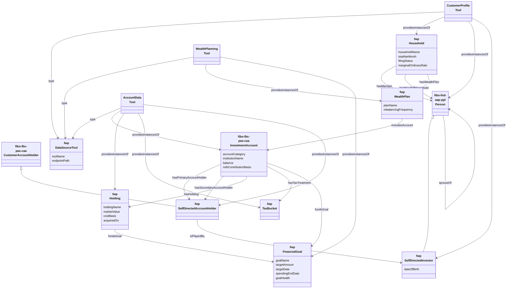

# Self-Directed Investor Wealth Planning — Data Specification

This is the data contract for the [OntologyRAG and GraphRAG use case](README.md). Implementation must follow this file. It is a technical specification of the schema and the household fixture. It is not tax, legal, or investment advice.

## Normative model

Namespace: `http://example.org/ontology/fwp#`

### Structure

Each box is one class, except the three tool boxes, which are reference individuals of `fwp:DataSourceTool`. The prefix is wrapped onto its own lines inside the box. Boxes show a subset of the datatype properties. The property tables are the full list. `hasHeadOfHousehold` is a subproperty of `hasMember`. Each tool points at the classes its endpoint returns. AccountData also returns `fibo-fbc-pas-caa:CustomerAccount` on the same account individual. Holder properties are drawn on `InvestmentAccount`. Their FIBO domain is `CustomerAccount`.

### Instance overlay

The Schema section is the structural model. The Tools section is the three data-source individuals from the Turtle file. The Instance section is `sdi_household_instance.jsonld`. Dashed `type` arrows cross from each instance to a schema class, and from each tool to `fwp:DataSourceTool`. `providesInstancesOf` arrows connect a tool to the schema classes in its response. The three tax-bucket individuals are reference data in the Turtle file. Accounts point at them with `hasTaxTreatment`.

```mermaid
classDiagram
  direction BT
  namespace Schema {
    class Household["fwp<br>Household"] {
      householdName
      totalNetWorth
      filingStatus
    }
    class WealthPlan["fwp<br>WealthPlan"] {
      planName
      rebalancingFrequency
    }
    class FinancialGoal["fwp<br>FinancialGoal"] {
      goalName
      targetAmount
      targetDate
      goalHealth
    }
    class TaxBucket["fwp<br>TaxBucket"]
    class Holding["fwp<br>Holding"] {
      holdingName
      marketValue
      costBasis
    }
    class Person["fibo-fnd-<br>aap-ppl<br>Person"]
    class Investor["fwp<br>SelfDirectedInvestor"] {
      dateOfBirth
    }
    class CustHolder["fibo-fbc-<br>pas-caa<br>CustomerAccountHolder"]
    class SdHolder["fwp<br>SelfDirectedAccountHolder"]
    class InvestmentAccount["fibo-fbc-<br>pas-caa<br>InvestmentAccount"] {
      accountCategory
      institutionName
      balance
    }
    class DataSourceTool["fwp<br>DataSourceTool"] {
      toolName
      endpointPath
    }
  }
  namespace Tools {
    class ProfileTool["CustomerProfile<br>Tool"] {
      CustomerProfile
      customer-profile
    }
    class PlanTool["WealthPlanning<br>Tool"] {
      WealthPlanning
      wealth-planning
    }
    class AccountTool["AccountData<br>Tool"] {
      AccountData
      account-data
    }
  }
  namespace Instance {
    class Miller["household_miller<br>Household"] {
      net worth 2450000
      filing jointly
      ordinary rate 0.32
    }
    class David["person_david_miller<br>SelfDirectedInvestor"] {
      David Miller
      born 1979-06-15
    }
    class Elena["person_elena_miller<br>SelfDirectedInvestor"] {
      Elena Miller
      born 1981-04-03
    }
    class HolderDavid["holder_david<br>SelfDirectedAccountHolder"]
    class HolderElena["holder_elena<br>SelfDirectedAccountHolder"]
    class Plan["plan_miller_core<br>WealthPlan"] {
      quarterly
      rebalancing
    }
    class TaxableAcct["account_taxable_brokerage<br>InvestmentAccount"] {
      Joint taxable
      Charles Schwab
      balance 1200000
    }
    class RothAcct["account_roth_ira<br>InvestmentAccount"] {
      Roth IRA
      Vanguard
      balance 450000
      contribution basis 150000
    }
    class TradAcct["account_traditional_ira<br>InvestmentAccount"] {
      Traditional IRA
      Fidelity
      balance 800000
      nondeductible basis 0
    }
    class Bridge["goal_early_retirement<br>FinancialGoal"] {
      target 1500000
      by 2032-12-31
      ends 2038-12-15
    }
    class TaxFreeGoal["goal_tax_free_growth<br>FinancialGoal"] {
      target 1000000
      by 2045-01-01
    }
    class IncomeGoal["goal_retirement_income<br>FinancialGoal"] {
      target 1500000
      by 2038-12-15
    }
    class SchwabHolding["holding_schwab_equity<br>Holding"] {
      equity ETF
      value 1200000
      cost basis 720000
    }
    class VanguardHolding["holding_vanguard_equity<br>Holding"] {
      equity index
      value 450000
    }
    class BondHolding["holding_fidelity_bond<br>Holding"] {
      bond fund
      value 800000
    }
    class BucketTaxable["Taxable"]
    class BucketDeferred["TaxDeferred"]
    class BucketFree["TaxFree"]
  }
  Household --> Person : hasMember
  Household --> Person : hasHeadOfHousehold
  Household --> WealthPlan : hasWealthPlan
  Person --> Person : spouseOf
  Person <|-- Investor
  CustHolder <|-- SdHolder
  SdHolder --> Investor : isPlayedBy
  InvestmentAccount --> SdHolder : hasPrimaryAccountHolder
  InvestmentAccount --> SdHolder : hasSecondaryAccountHolder
  WealthPlan --> InvestmentAccount : includesAccount
  InvestmentAccount --> Holding : hasHolding
  InvestmentAccount --> TaxBucket : hasTaxTreatment
  InvestmentAccount --> FinancialGoal : fundsGoal
  Holding --> FinancialGoal : fundsGoal
  Miller --> David : hasHeadOfHousehold
  Miller --> Elena : hasMember
  Miller --> Plan : hasWealthPlan
  David --> Elena : spouseOf
  TaxableAcct --> HolderDavid : hasPrimaryAccountHolder
  RothAcct --> HolderDavid : hasPrimaryAccountHolder
  TradAcct --> HolderDavid : hasPrimaryAccountHolder
  TaxableAcct --> HolderElena : hasSecondaryAccountHolder
  HolderDavid --> David : isPlayedBy
  HolderElena --> Elena : isPlayedBy
  Plan --> TaxableAcct : includesAccount
  Plan --> RothAcct : includesAccount
  Plan --> TradAcct : includesAccount
  TaxableAcct --> BucketTaxable : hasTaxTreatment
  RothAcct --> BucketFree : hasTaxTreatment
  TradAcct --> BucketDeferred : hasTaxTreatment
  TaxableAcct --> SchwabHolding : hasHolding
  RothAcct --> VanguardHolding : hasHolding
  TradAcct --> BondHolding : hasHolding
  TaxableAcct --> Bridge : fundsGoal
  RothAcct --> TaxFreeGoal : fundsGoal
  TradAcct --> IncomeGoal : fundsGoal
  Miller ..> Household : type
  David ..> Investor : type
  Elena ..> Investor : type
  HolderDavid ..> SdHolder : type
  HolderElena ..> SdHolder : type
  Plan ..> WealthPlan : type
  TaxableAcct ..> InvestmentAccount : type
  RothAcct ..> InvestmentAccount : type
  TradAcct ..> InvestmentAccount : type
  Bridge ..> FinancialGoal : type
  TaxFreeGoal ..> FinancialGoal : type
  IncomeGoal ..> FinancialGoal : type
  SchwabHolding ..> Holding : type
  VanguardHolding ..> Holding : type
  BondHolding ..> Holding : type
  BucketTaxable ..> TaxBucket : type
  BucketDeferred ..> TaxBucket : type
  BucketFree ..> TaxBucket : type
  ProfileTool ..> DataSourceTool : type
  PlanTool ..> DataSourceTool : type
  AccountTool ..> DataSourceTool : type
  ProfileTool --> Household : providesInstancesOf
  ProfileTool --> Person : providesInstancesOf
  ProfileTool --> Investor : providesInstancesOf
  PlanTool --> WealthPlan : providesInstancesOf
  PlanTool --> FinancialGoal : providesInstancesOf
  AccountTool --> InvestmentAccount : providesInstancesOf
  AccountTool --> Holding : providesInstancesOf
  AccountTool --> TaxBucket : providesInstancesOf
  AccountTool --> SdHolder : providesInstancesOf
```

### Classes

| Class | Alignment | Meaning |
| --- | --- | --- |
| `fwp:SelfDirectedInvestor` | Subclass of `fibo-fnd-aap-ppl:Person`, which is a `cmns-pts:Party`. | The person who selects the investments. Ownership is the account-holder role that person plays. |
| `fwp:SelfDirectedAccountHolder` | Subclass of `fibo-fbc-pas-caa:CustomerAccountHolder`. | The ownership role played by that person. FIBO does not make the person the account holder. |
| `fwp:Household` | None. FIBO has no household class, and a household is not an agent. | Planning and filing unit. |
| `fwp:WealthPlan` | None. FIBO has no household wealth-plan class. | The policy that covers the accounts. |
| `fwp:FinancialGoal` | None. FIBO has no financial-goal class. | A target amount on a target date. |
| `fwp:TaxBucket` | None. FIBO has no tax-wrapper class. | Taxable, tax-deferred, or tax-free. |
| `fwp:Holding` | None. FIBO's position classes are fund constituents, not a retail lot. | A position inside one investment account. |
| `fwp:DataSourceTool` | None. The tool catalog is local to this retrieval flow. | API that returns individuals of the classes linked by `fwp:providesInstancesOf`. |

Account range: `fibo-fbc-pas-caa:InvestmentAccount` in `https://spec.edmcouncil.org/fibo/ontology/FBC/ProductsAndServices/ClientsAndAccounts/`. FIBO defines that class as an account that records funds and securities held at an institution. There is no `fibo-fbc-pas-fpas:FinancialAccount`. There is no `fibo-sec-eq-pos:Position` module in current FIBO. Investors extend `fibo-fnd-aap-ppl:Person`. Their account-holder roles extend `fibo-fbc-pas-caa:CustomerAccountHolder`. Retail accounts are also `CustomerAccount`, the domain of the FIBO holder properties. Names use `fibo-fnd-aap-ppl:hasPersonName`. `fwp:dateOfBirth` stays a date literal because FIBO `hasDateOfBirth` points at a `DateOfBirth` individual.

Pin the FIBO quarterly release in the demo environment. These IRIs move.

### Data source tools

`fwp:DataSourceTool` is the schema entity for an API that returns instance data. `fwp:providesInstancesOf` is the stored link from a tool to the schema classes in its response. The class IRI is the object of that link, which is OWL 2 punning, and `rdfs:range rdfs:Class` records it. An OWL 2 DL reasoner can reject that range because `rdfs:Class` is reserved vocabulary. The SPARQL walk uses the asserted triples and does not need the range axiom.

`fwp:providedByTool` is declared `owl:inverseOf` `fwp:providesInstancesOf`. The reverse triple is not stored. Retrieval follows `^fwp:providesInstancesOf`, or the inverse triple after a reasoner runs. The same applies to `fwp:heldIn` and to `fwp:spouseOf` in the reverse direction.

The paths below are example endpoints in the same `http://example.org` namespace as the ontology. They are the contract the agent calls. They are not live product URLs, and they take no household or account parameter. This demo is already scoped to `fwp:household_miller`. Load the Turtle file for the TBox, the tax-bucket individuals, and the tool catalog. The JSON-LD file is the merged household graph after the three responses have been aligned.

| Tool | Endpoint | Classes in the response |
| --- | --- | --- |
| CustomerProfile | `http://example.org/api/tools/customer-profile` | `fwp:Household`, `fibo-fnd-aap-ppl:Person`, `fwp:SelfDirectedInvestor` |
| WealthPlanning | `http://example.org/api/tools/wealth-planning` | `fwp:WealthPlan`, `fwp:FinancialGoal` |
| AccountData | `http://example.org/api/tools/account-data` | `fibo-fbc-pas-caa:InvestmentAccount`, `fibo-fbc-pas-caa:CustomerAccount`, `fwp:Holding`, `fwp:TaxBucket`, `fwp:SelfDirectedAccountHolder` |

A tool response contains only the classes that tool provides. A response is aligned by matching `@type` and property IRIs to this schema. Links to another tool's objects stay IRIs until the payloads are merged. The plan's `includesAccount` values are account IRIs that AccountData fills in. The account's holder role is an AccountData individual whose `isPlayedBy` value is a person IRI from CustomerProfile. `fwp:fundsGoal` is asserted on the account, so the goal IRI on an account is resolved from WealthPlanning.

The $50,000 question grounds to person, goal, account, holding, and tax bucket, so the agent calls all three tools before the graph walk. CustomerProfile supplies the household, the two investors, ages, filing status, and the tax rates. WealthPlanning supplies the plan, the goals, and the `includesAccount` IRIs. AccountData supplies the accounts, holdings, holder roles, balances, lot basis, account basis, `hasTaxTreatment` IRIs, and `fundsGoal`. The tax-bucket individuals themselves are in the Turtle file.

OWL domain and range axioms are open-world inferences: if `fwp:includesAccount` relates two resources, a reasoner can infer their types. They do not reject a bad instance. Closed-world checks belong in SHACL shapes, which this example does not yet include. A prefix declaration does not import FIBO. `owl:imports` would. This schema only aligns to FIBO by IRI, so FIBO axioms are not applied unless those modules are loaded.

### Reference individuals

`fwp:Taxable`, `fwp:TaxDeferred`, and `fwp:TaxFree` are individuals of `fwp:TaxBucket`. They are reference data, shared by every household, not strings restated inside each account.

### Properties the instance is allowed to use

Object properties:

| Property | Domain | Range |
| --- | --- | --- |
| `fwp:hasMember` | `fwp:Household` | `fibo-fnd-aap-ppl:Person` |
| `fwp:hasHeadOfHousehold` | subproperty of `fwp:hasMember` | inherits the member range |
| `fwp:spouseOf` | `fibo-fnd-aap-ppl:Person` | `fibo-fnd-aap-ppl:Person` |
| `fwp:hasWealthPlan` | `fwp:Household` | `fwp:WealthPlan` |
| `fwp:includesAccount` | `fwp:WealthPlan` | `fibo-fbc-pas-caa:InvestmentAccount` |
| `fibo-fbc-pas-caa:hasPrimaryAccountHolder` | `fibo-fbc-pas-caa:CustomerAccount` | `fibo-fbc-pas-caa:CustomerAccountHolder` |
| `fibo-fbc-pas-caa:hasSecondaryAccountHolder` | `fibo-fbc-pas-caa:CustomerAccount` | `fibo-fbc-pas-caa:CustomerAccountHolder` |
| `cmns-rlcmp:isPlayedBy` | account-holder role | `fibo-fnd-aap-ppl:Person` |
| `fwp:hasTaxTreatment` | `fibo-fbc-pas-caa:InvestmentAccount` | `fwp:TaxBucket` |
| `fwp:hasHolding` | `fibo-fbc-pas-caa:InvestmentAccount` | `fwp:Holding` |
| `fwp:heldIn` | inverse of `fwp:hasHolding`. Functional. | the account |
| `fwp:fundsGoal` | `fibo-fbc-pas-caa:InvestmentAccount` or `fwp:Holding` | `fwp:FinancialGoal` |
| `fwp:providesInstancesOf` | `fwp:DataSourceTool` | schema class |
| `fwp:providedByTool` | inverse of `fwp:providesInstancesOf` | `fwp:DataSourceTool` |

Datatype properties:

| Property | Domain | Range |
| --- | --- | --- |
| `fwp:householdName` | `fwp:Household` | `xsd:string` |
| `fwp:totalNetWorth` | `fwp:Household` | `xsd:decimal` |
| `fwp:asOfDate` | `fwp:Household` | `xsd:date` |
| `fwp:taxYear` | `fwp:Household` | `xsd:gYear` |
| `fwp:filingStatus` | `fwp:Household` | `xsd:string` |
| `fwp:marginalOrdinaryRate` | `fwp:Household` | `xsd:decimal` |
| `fwp:longTermCapitalGainsRate` | `fwp:Household` | `xsd:decimal` |
| `fwp:netInvestmentIncomeTaxRate` | `fwp:Household` | `xsd:decimal` |
| `fwp:planName` | `fwp:WealthPlan` | `xsd:string` |
| `fwp:rebalancingFrequency` | `fwp:WealthPlan` | `xsd:string` |
| `fibo-fnd-aap-ppl:hasPersonName` | `fibo-fnd-aap-ppl:Person` | text |
| `fwp:dateOfBirth` | `fibo-fnd-aap-ppl:Person` | `xsd:date` |
| `fwp:accountCategory` | Investment account | `xsd:string` |
| `fwp:institutionName` | Investment account | `xsd:string` |
| `fwp:balance` | Investment account | `xsd:decimal` |
| `fwp:rothContributionBasis` | Investment account | `xsd:decimal` |
| `fwp:iraNondeductibleBasis` | Investment account | `xsd:decimal` |
| `fwp:holdingName` | `fwp:Holding` | `xsd:string` |
| `fwp:marketValue` | `fwp:Holding` | `xsd:decimal` |
| `fwp:costBasis` | `fwp:Holding` | `xsd:decimal` |
| `fwp:acquiredOn` | `fwp:Holding` | `xsd:date` |
| `fwp:goalName` | `fwp:FinancialGoal` | `xsd:string` |
| `fwp:targetAmount` | `fwp:FinancialGoal` | `xsd:decimal` |
| `fwp:targetDate` | `fwp:FinancialGoal` | `xsd:date` |
| `fwp:spendingEndDate` | `fwp:FinancialGoal` | `xsd:date` |
| `fwp:goalHealth` | `fwp:FinancialGoal` | `xsd:string` |
| `fwp:toolName` | `fwp:DataSourceTool` | `xsd:string` |
| `fwp:endpointPath` | `fwp:DataSourceTool` | `xsd:anyURI` |

`fibo-fbc-pas-caa:hasPrimaryAccountHolder` and `hasSecondaryAccountHolder` are ownership. The holder role is played by the investor through `cmns-rlcmp:isPlayedBy`. `fwp:includesAccount` means the plan covers the account. `fwp:hasHolding` places a holding inside one account, and `fwp:heldIn` is its functional inverse. Market values of an account's holdings sum to that account's balance. `fwp:fundsGoal` assigns that whole balance to the goal. The taxable holding's `fwp:costBasis` and `fwp:acquiredOn` are lot facts. `fwp:rothContributionBasis` and `fwp:iraNondeductibleBasis` are account tax basis, not lot cost basis.

`fwp:heldIn` and the reverse of `fwp:spouseOf` are not stored as extra triples. A reasoner applies `owl:inverseOf` and `owl:SymmetricProperty`. A query can walk `^fwp:hasHolding` and treat `spouseOf` as symmetric. The `fwp` properties used in the JSON-LD are declared in the Turtle file. `fibo-fnd-aap-ppl:hasPersonName`, `fibo-fbc-pas-caa:hasPrimaryAccountHolder`, `fibo-fbc-pas-caa:hasSecondaryAccountHolder`, and `cmns-rlcmp:isPlayedBy` are external IRIs. This file uses them and does not declare them. A prefix does not import their axioms.

`fwp:targetDate` is the date the target amount must be available. On the bridge goal, `fwp:spendingEndDate` is the day David reaches age 59.5, 2038-12-15, from a birth date of 1979-06-15. `fwp:goalHealth` is an asserted status. This example uses `Shortfall` because each balance is below its target. Rates sit on the household return for tax year 2026, not on one person. The 0.038 net-investment-income rate is asserted because a household in the 0.32 ordinary bracket filing jointly is above the $250,000 threshold. The ontology does not compute MAGI. `fwp:institutionName` is a custodian name. A FIBO-native model would link an account-provider party.

### Household facts the instance asserts

Balances add up to `fwp:totalNetWorth`. There are no liabilities and no assets outside these accounts. Values are as of 2026-10-23.

| Account | Registration | Owner | Custodian | Bucket | Balance | Holding | Funds |
| --- | --- | --- | --- | --- | --- | --- | --- |
| Joint taxable brokerage | `fwp:accountCategory` | David and Elena | Charles Schwab | `fwp:Taxable` | 1200000.00 | Total market equity ETF. Market value 1200000.00. Cost basis 720000.00. Acquired 2019-06-14. | Bridge. Target 1500000.00 by 2032-12-31. Spending ends 2038-12-15. |
| Roth IRA | Roth IRA | David | Vanguard | `fwp:TaxFree` | 450000.00 | Global equity index fund. Contribution basis 150000.00. Earnings 300000.00. | Tax-free growth. Target 1000000.00 by 2045-01-01. |
| Traditional IRA | Traditional IRA | David | Fidelity | `fwp:TaxDeferred` | 800000.00 | US aggregate bond fund. Nondeductible basis 0.00. | Retirement income. Target 1500000.00 by 2038-12-15. |

1200000 + 450000 + 800000 = 2450000.

David is head of household, born 1979-06-15, so he is 47 on the as-of date and turns 53 in 2032. Elena, born 1981-04-03, is his spouse. The return is married filing jointly. Ordinary marginal rate 0.32. Long-term capital gains rate 0.15. The JSON-LD document is one `@graph`. Money and dates are typed as `xsd:decimal` and `xsd:date`.

## What the $50,000 question is allowed to conclude

The graph supports these facts. The 10 percent additional tax on an early distribution, and the Roth ordering rules, are not axioms in the files. A presenter applies them to the facts below. This is still a retrieval demonstration, not tax advice.

- Schwab is the joint taxable account. It holds one equity lot acquired on 2019-06-14. On the as-of date the presenter treats that lot as long-term under the one-year holding-period rule. Unrealized gain is 480000.00 of 1200000.00, so 0.40 of proceeds is gain. On 50000.00 of proceeds the gain is 20000.00. Tax at 0.15 plus 0.038 is 3760.00. Net cash is 46240.00. Raising 50000.00 after that tax takes 54065.74 of proceeds. The sale reduces the bridge, which is already 300000.00 short of 1500000.00. He is under 59.5, so this sale has no early-distribution additional tax.
- Vanguard is David's Roth. Contribution basis is 150000.00 and earnings are 300000.00. He is 47, so a distribution of earnings is not a qualified distribution. A withdrawal that stays inside the contribution basis is the Roth fact the graph can show. It reduces the tax-free goal.
- Fidelity is David's traditional IRA. Nondeductible basis is 0.00, so a distribution is pre-tax ordinary income. At 0.32, tax on 50000.00 is 16000.00 before any early-distribution additional tax. The account holds the bond fund and funds income that starts on 2038-12-15.
- Equities are in the taxable account and the Roth. The bond fund is in the traditional IRA.

The language model does not learn the early-distribution additional tax from a prefix. The orchestrator has to hand it the subgraph and that rule.

## What remains outside these files

FIBO modules are aligned by IRI and are not `owl:imports`. SHACL shapes are not included, so the balance-equals-holdings rule and the one-owner rule for an IRA are comments, not validators. Rebalancing frequency is recorded, and target weights are not. A holding is not linked to a FIBO instrument. The one-year holding-period rule, the early-distribution additional tax, and Roth qualified-distribution rules are not axioms. The tool endpoints are not implemented services. The JSON-LD file is the merged fixture for this household.
