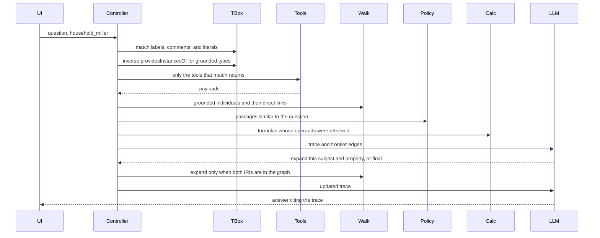

# Demo application — technical specification

This document plans the application that runs the [use case](../README.md) against the [data contract](../SPEC.md). No application code is in this folder yet.

The demo runs the questions below through one loop and shows every step on screen. One example is:

> I need $50,000 for an unexpected expense. Should I take it from the Schwab account or the Vanguard account?

A useful answer follows holder, tax-bucket, holding, and goal links, then applies withdrawal rules that are not in the ontology. The screen is a trace of that work. It is a retrieval demonstration. It is not tax, legal, or investment advice.

## What the audience sees

The question is prefilled and the household is fixed as `fwp:household_miller`. Running it appends one card per step, in order. Each card shows its input, its output, and the triples or passages that step added. The final card is the answer, with citations back to earlier cards.

Every question uses the same loop. Nothing in the controller picks a path from the wording.

```text
Match the question to labels, comments, and literals in the graph
  → tools are whatever ^providesInstancesOf returns for the grounded types
  → query the household JSON-LD with those tools
  → merge the payloads with the Turtle file
  → keep triples that touch a grounded individual, plus literals on the other end of each triple
  → policy passages similar to the question, and calculator formulas whose operands were retrieved
  → model may name one more subject and property
  → controller expands that pair only when both IRIs are already in the graph
  → final answer cites the trace
```

A question that matches the Schwab account does not describe the Fidelity IRA. The plan links both accounts, and following that link would put Fidelity's balance, basis, and goal into the prompt even though the question never named them. The model could then talk about Fidelity as if it had been asked. The walk stops at the grounded accounts. Fidelity stays out of the trace unless the question matches it, or the model asks to follow `fwp:includesAccount` and that expansion is shown as its own step.

## Question checks

The names in this section are checks, not branches. The runtime never reads them. Each check lists phrasings that should match the same graph text and therefore the same seed IRIs. The facts are what a two-hop neighborhood of those seeds contains. The model may phrase the prose differently. It may cite only triples and passages on that trace.

| Check | Facts the neighborhood of the matched seeds contains |
| --- | --- |
| `withdrawal` | Schwab is the joint taxable account. Its lot was acquired 2019-06-14. On 50,000 of proceeds the gain is 20,000 and the tax is 3,760, so net cash is 46,240. Netting 50,000 takes 54,065.74 of proceeds and widens the bridge shortfall of 300,000. Vanguard is David's Roth: contribution basis 150,000, earnings 300,000, and he is 47, so earnings are not a qualified distribution. The Fidelity IRA is not in the trace, and the answer does not cite it. |
| `bridge_funding` | `fwp:goal_early_retirement` is funded by `fwp:account_taxable_brokerage` through `fwp:fundsGoal`. Balance 1,200,000, target 1,500,000 by 2032-12-31, spending ends 2038-12-15, status Shortfall. The Schwab holding sits inside that account and has no `fwp:fundsGoal` of its own. The Roth and the traditional IRA fund the other two goals. |
| `roth_owner` | The Vanguard Roth has one holder role, `fwp:holder_david`, played by David through `cmns-rlcmp:isPlayedBy`. Elena is not a holder. David remains a `fwp:SelfDirectedInvestor`. The holder role is the ownership fact. |
| `asset_location` | The US aggregate bond fund is the holding in the Fidelity traditional IRA, bucket `fwp:TaxDeferred`. Equities are the total market equity ETF in the Schwab taxable account and the global equity index fund in the Vanguard Roth. Quarterly rebalancing is recorded. Target weights are not. |
| `filing_unit` | David and Elena are members. David is head, and the member query returns him again because `fwp:hasHeadOfHousehold` is a subproperty of `fwp:hasMember`. Elena is his spouse. Filing status is married filing jointly. |
| `tax_treatment` | The Schwab account's registration is "Joint taxable brokerage" (`fwp:accountCategory`). Its tax treatment is the individual `fwp:Taxable` via `fwp:hasTaxTreatment`. The two facts stay separate. |
| `no_such_fact` | The trace has no target weights and no computed 10 percent additional tax. The answer says those values are not in the retrieved context. |

Phrasings:

**`withdrawal`.** The phrasings match the Schwab and Vanguard account literals. Each seed is described with its holding, tax bucket, goal, and holder. The Fidelity account is not described.

- I need $50,000 for an unexpected expense. Should I take it from the Schwab account or the Vanguard account?
- Where should I pull fifty thousand dollars, Charles Schwab or the Roth at Vanguard?
- If I have to raise 50000 in cash, which is the better source, the joint brokerage or the Vanguard IRA?

**`bridge_funding`.** The phrasings match the bridge goal's name, which includes "age 53" and "59.5". The inverse of `fwp:fundsGoal` reaches the Schwab account.

- Which account is funding the early retirement bridge?
- What pays for the goal that runs until David is 59 and a half?
- Where does the money for the age-53 bridge sit?

**`roth_owner`.** The phrasings match Elena's name and the Vanguard account literals. The holder link from that account reaches David.

- Who owns the Vanguard account?
- Is Elena on the Roth IRA?
- Whose name is on the Vanguard Roth?

**`asset_location`.** The phrasings match the holding-name literals "bond" and "equity". `fwp:heldIn` reaches each account, and `fwp:hasTaxTreatment` reaches its bucket.

- Where are the bonds?
- Which account holds the bond fund?
- Are the equities in the taxable account and the Roth?

**`filing_unit`.** The phrasings match the household name and the household comment that these people file together. `fwp:hasMember` includes `fwp:hasHeadOfHousehold` because the TBox says it is a subproperty.

- Who is in the Miller household?
- Who files this return?
- Is the head of household also a member?

**`tax_treatment`.** The phrasings match the Schwab account and the labels on `fwp:accountCategory` ("account registration") and `fwp:TaxBucket`.

- What is the tax treatment of the Schwab account?
- Is the joint brokerage taxable, or is that just its registration?
- Which tax bucket is the Charles Schwab account in?

**`no_such_fact`.** The phrasings match `fwp:rebalancingFrequency` and the early-distribution passage. The graph has no target-weight property and no penalty amount, so the answer says those values were not retrieved.

- What should the quarterly rebalance buy?
- What are the target weights?
- How much is the 10 percent early-distribution penalty on a Fidelity withdrawal?

## Tech stack

| Piece | Choice | Role |
| --- | --- | --- |
| API | Python 3.12, FastAPI | Loads the RDF files, runs the loop, streams trace events. |
| RDF | [rdflib](https://rdflib.readthedocs.io/) | Parses the Turtle TBox and the JSON-LD ABox. Tool payloads and the graph walk are SPARQL. |
| Reasoning | SPARQL property paths | `^fwp:providesInstancesOf`, `^fwp:hasHolding`, and `fwp:hasMember` / `fwp:hasHeadOfHousehold` via `rdfs:subPropertyOf`. No OWL DL reasoner. |
| Embeddings | [fastembed](https://github.com/qdrant/fastembed) in process | One in-memory index. It embeds the graph lexicon used to pick seeds before the walk: `rdfs:label`, `rdfs:comment`, datatype literals, and camel-case local names. It also embeds the policy passages. No separate vector database. A lexical overlap ranker is the fallback when the model is not loaded. |
| Arithmetic | Python function | Computes the figures in [SPEC.md](../SPEC.md#what-the-50000-question-is-allowed-to-conclude) from retrieved decimals. |
| Model | OpenAI-compatible chat endpoint | `LLM_BASE_URL`, `LLM_API_KEY`, and `LLM_MODEL` in the environment. The model explains retrieved facts. It does not choose tools and it does not originate the tax figures. |
| UI | Vite, React, TypeScript | Step timeline. Cards appear as server-sent events arrive. |
| Stream | `POST /api/ask` as `text/event-stream` | One JSON event per step, then a final event. |

The parent folder is the data contract. This demo does not copy the ontology into a database and does not call the example `http://example.org` URLs. Those paths are labels on the tool individuals. The implementation of each tool is a SPARQL projection over `sdi_household_instance.jsonld`.

## Planned layout

```text
demo/
  README.md                 this specification
  backend/
    pyproject.toml
    app/
      store.py              load TTL + JSON-LD
      tools.py              three projections
      grounding.py          match question text to the graph
      walk.py               GraphRAG neighborhood
      policy.py             passages and embeddings
      calculator.py         SPEC arithmetic
      loop.py               controller
      llm.py                chat adapter
    policy/                 short passages, outside the ontology
  frontend/
    index.html
    src/                    timeline, question, answer
```

## Runtime



On startup the process loads the two source files into one rdflib graph.

| File | Role |
| --- | --- |
| `sdi_wealth_schema_fixed.ttl` | TBox. Classes, properties, tax-bucket individuals, and the three data-source tools. |
| `sdi_household_instance.jsonld` | ABox. The merged household graph after the three tool responses are aligned. |

Tool projections are queries over that graph. The merged working graph for the walk is the union of the three payloads and the Turtle file, which is the same graph the process already loaded. The merge card still draws the cross-tool IRIs resolving, so the audience sees the contract from [SPEC.md](../SPEC.md#data-source-tools).

## OntologyRAG grounding

Grounding builds its lexicon from the loaded graph. There is no phrase list and no intent id.

At startup the corpus is every `rdfs:label`, every `rdfs:comment`, every datatype literal, and the local name of every IRI, split on camel case and underscores. A hit is a case-insensitive containment of one of those strings in the question, or an embedding of the question near that string. The embedding ranker and the lexical ranker are the same function used for policy passages. The card shows the matched string, the IRI it came from, and the score.

A matched individual is a seed. A matched class is a class seed. A matched property adds that property and the classes in its domain and range. The household chip adds `fwp:household_miller` as a seed on every run.

Tool selection walks `^fwp:providesInstancesOf` from each class seed and from each `rdf:type` of an individual seed, including superclasses declared in the Turtle file. It does not look for a stored `fwp:providedByTool` triple. The card lists each class and the tool that triple returned. A question that only matches account literals calls AccountData. A question that also matches a goal name or a person name calls the tool bound to that type. The same words match the same literals, so paraphrases that share those strings share the same seeds. Words that match nothing in the graph add no seed. The fix for a missed phrasing is a label or comment in the ontology, not a branch in the controller.

`fwp:hasHeadOfHousehold` is an `rdfs:subPropertyOf` `fwp:hasMember`. The member lookup is a SPARQL property path that follows `rdfs:subPropertyOf*`. The card shows David returned both as the asserted head and as a member through that path. Elena is an asserted member.

## Tool queries

Each tool returns only the classes in its [binding](../SPEC.md#data-source-tools). A node belongs to a tool when one of its `rdf:type` values, or a superclass declared in the Turtle file, is in that binding. `fwp:SelfDirectedInvestor` therefore satisfies the Person binding on CustomerProfile. An account satisfies AccountData through both `InvestmentAccount` and `CustomerAccount`.

Serialization rules:

- Datatype properties of an included subject are included.
- An object property whose object is also included is expanded. AccountData expands `fwp:hasHolding` because the holding is in that tool.
- An object property whose object belongs to another tool is emitted as an IRI only. The plan's `fwp:includesAccount` values stay IRIs. `fwp:fundsGoal` stays a goal IRI on the account. `cmns-rlcmp:isPlayedBy` stays a person IRI on the holder. `fwp:hasWealthPlan` stays a plan IRI on the household.
- The three `fwp:TaxBucket` individuals are read from the Turtle file when AccountData runs. The card names that file. They are not restated inside `sdi_household_instance.jsonld`.

The JSON-LD file nests accounts and goals inside the plan. The queries lift each subject by IRI. WealthPlanning returns the plan and the three goals as separate nodes. AccountData returns the three accounts, three holdings, and two holder roles.

| Tool | Query returns | Leaves as IRIs |
| --- | --- | --- |
| CustomerProfile | `fwp:household_miller`, David, Elena, names, birth dates, filing status, rates, `fwp:spouseOf` | `fwp:hasWealthPlan` |
| WealthPlanning | `fwp:plan_miller_core`, three goals, names, amounts, dates, `fwp:goalHealth` | `fwp:includesAccount` |
| AccountData | three accounts, three holdings, two holder roles, balances, basis, tax-bucket individuals from the Turtle file | holder `isPlayedBy`, `fwp:fundsGoal` |

`fwp:spouseOf` is stored only from David to Elena. The projection does not invent the reverse triple. A later card may show the symmetric reading by query, and it labels that reading as `owl:SymmetricProperty` rather than as a stored fact.

## GraphRAG walk

The walk is the same neighborhood function for every question. It is not a community-summary index, and it does not switch on the check name.

The walk has one pattern for every class. `?seed` is whatever individual the text match grounded. A property hop also follows `rdfs:subPropertyOf*`, so a `fwp:hasMember` hop includes `fwp:hasHeadOfHousehold`.

```sparql
VALUES ?seed { <the grounded individual IRIs> }
{ ?seed ?property ?neighbor }
UNION
{ ?neighbor ?property ?seed }
?neighbor ?literalProperty ?literal .
FILTER (isLiteral(?literal))
```

The union keeps a triple when the seed is either the subject or the object. The literal pattern names that neighbor. It does not follow a second object property out of the neighbor. There is no account rule, plan rule, or holder rule.

Applied to a Schwab seed, the outgoing triples bind its holding, tax bucket, goal, and holder role, and the literals on those nodes. The incoming `fwp:includesAccount` triple binds the plan, and the literals on the plan. It does not bind the plan's other `fwp:includesAccount` objects, so the Fidelity account is not in the result. The same pattern applied to a goal seed binds the account on the other end of `fwp:fundsGoal` and stops there. The same pattern applied to a holding seed binds its account and stops there.

A second hop runs only as an expansion the trace shows. The model names a neighbor already in the result and a property in the TBox. That is how a holder role becomes a person: the first pattern returns the holder IRI, and the expansion follows `cmns-rlcmp:isPlayedBy`. The same expansion is how the plan's other accounts would be retrieved. Until that card appears, those individuals are not in the context.

The walk card draws the triples the pattern returned. A holder role is in the first result. The person on the other side of `cmns-rlcmp:isPlayedBy` appears only after an expansion card.

Holdings do not have `fwp:fundsGoal` in this fixture. The card shows the account-level link only.

## Policy index

Passages live in `demo/backend/policy/` as short original paragraphs. They state the presenter rules that [SPEC.md](../SPEC.md#what-remains-outside-these-files) keeps outside the ontology:

- A lot acquired more than one year before the as-of date is treated as long-term. The ontology stores `fwp:acquiredOn` and does not store that rule.
- For this demo, tax on a taxable sale is the gain portion times `fwp:longTermCapitalGainsRate` plus `fwp:netInvestmentIncomeTaxRate`.
- Roth contribution basis and earnings are different amounts. Earnings are not a qualified distribution at the retrieved age. Ordering of Roth withdrawals is a passage, not an axiom.
- A traditional IRA distribution with `fwp:iraNondeductibleBasis` of zero is pre-tax ordinary income at `fwp:marginalOrdinaryRate`. The 10 percent early-distribution additional tax is described in a passage and is not computed.

At startup each passage is embedded with fastembed, using the same ranker as grounding. The query is the question text. The card shows the scores and the passage ids above the cutoff. Passages below the cutoff stay out. A lexical overlap ranker implements the same search function when the embedding model cannot be loaded, and the card says which ranker ran.

## Calculator

The calculator is a set of formulas. A formula runs only when every operand is a number already in the neighborhood, plus a money amount parsed from the question when the formula needs one. A question whose neighborhood lacks a cost basis does not get a gain figure. When the $50,000 question's neighborhood has the operands, the formulas produce the figures the data contract checks:

- Taxable lot: gain ratio `(1,200,000 − 720,000) / 1,200,000 = 0.40`. On 50,000 of proceeds the gain is 20,000. Tax at 0.15 + 0.038 is 3,760. Net is 46,240. Proceeds to net 50,000 are `50000 / 0.9248 = 54065.74`.
- Bridge shortfall: `1,500,000 − 1,200,000 = 300,000`.
- Roth earnings: `450,000 − 150,000 = 300,000`.
- Traditional IRA tax on 50,000 at 0.32 is 16,000, before any early-distribution additional tax.
- Age on 2026-10-23 from 1979-06-15 is 47. Age 59.5 is 2038-12-15.
- Holding period: 2019-06-14 is more than one year before 2026-10-23, so the long-term passage applies. The card cites that passage.

The 10 percent additional tax is not an output. The card quotes the passage and stops.

## Model loop

The adapter sends the question, the trace so far, and a response schema:

```json
{
  "status": "expand | final",
  "expand": [{ "subject": "iri", "property": "iri" }],
  "answer": "string, present only when final",
  "citations": [{ "stepId": "string", "iri": "string", "note": "string" }]
}
```

Call one sees the neighborhood, the passages, the calculator output, and the unresolved frontier edges. It may name subject and property IRIs to expand, or it may return `final`. The controller expands a pair only when the subject is already in the neighborhood and the property is an object property in the TBox. Any other pair is dropped and shown on the trace as not in the graph. One expansion round is allowed. Call two, when it happens, must return `final`.

The system prompt tells the model to explain the trace, to avoid figures that are not in the calculator card, and to avoid rules that are not in a retrieved passage. The UI shows the prompt on the model card, collapsed, and the raw JSON above the rendered answer.

## Trace events

Every card is one server-sent event. `id` is stable for citations.

| `type` | Payload |
| --- | --- |
| `ground` | phrase, class or property, seed IRI |
| `tools` | tool name, endpoint label, classes that selected it |
| `tool_result` | tool name, source file, subjects, triples, IRIs left unresolved |
| `merge` | IRI, which payload defined it |
| `walk` | hop name, triples added |
| `inference` | subproperty or symmetric reading, query, result |
| `policy` | ranker, passage id, score, text |
| `calculator` | inputs, outputs, passage id for the holding-period rule |
| `model` | call number, prompt, raw JSON |
| `expand` | requested subject and property, and whether the graph accepted the pair |
| `final` | answer markdown and citations |

## Screen

One page.

- Header states that this is a retrieval demonstration and not tax advice.
- The question control lists the check phrasings. Choosing a second phrasing of the same check reruns the same loop. The household chip is `fwp:household_miller` and is not editable in this version.
- The timeline grows under the question. Tool cards show the projection, including IRIs that are not yet expanded. The walk card highlights the four paths. Model cards show call 1 and call 2 separately.
- The answer panel pins under the timeline and links each citation to its card.

The first version has no login and no second household. The model does not choose tools. Tools come from `fwp:providesInstancesOf` on the types the text match grounded. An expansion is executed only when the subject and the property are already in the graph.

## Acceptance

A scripted run against the current Turtle and JSON-LD files passes when:

1. A tool payload contains only the classes in its binding, with cross-tool links as IRIs. Tax-bucket individuals are attributed to the Turtle file when AccountData runs.
2. The Schwab phrasings ground to `fwp:account_taxable_brokerage` and `fwp:account_roth_ira` by matching literals. The neighborhood describes those accounts and does not describe `fwp:account_traditional_ira`.
3. The household phrasings return David as a member through `rdfs:subPropertyOf`, using that same walk.
4. Calculator outputs match the data-contract figures only when the operands were retrieved. No run outputs a 10 percent penalty amount.
5. Every phrasing in a check grounds to the same seed IRIs. The answer cites only IRIs and passages on that trace.
6. An expansion whose property is not in the TBox is dropped and is not cited.

## Build order

1. Load both RDF files and implement the three projections with tests for the partition rules.
2. Implement graph-text grounding and `^fwp:providesInstancesOf` selection.
3. Implement the grounded-individual walk, including subproperty paths, and leave unmentioned accounts unresolved.
4. Add the policy passages, embeddings, and the lexical fallback.
5. Add the calculator and lock its outputs to the data-contract figures.
6. Add the model adapter and the expansion check against the TBox.
7. Stream the trace over server-sent events.
8. Build the timeline page and run every phrasing in the question catalog in the browser.

Each step is demoable in a terminal before the page exists. The page is the last step because the trace schema above is the contract it renders.
