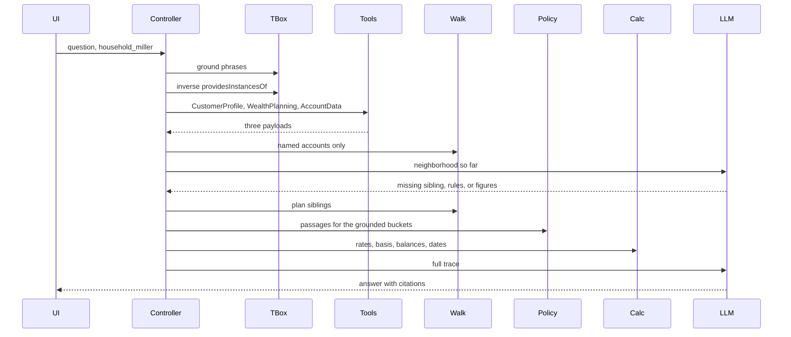

# Demo application — technical specification

This document plans the application that runs the [use case](../README.md) against the [data contract](../SPEC.md). No application code is in this folder yet.

The demo runs a fixed catalog of questions and shows every step on screen. The first intent is:

> I need $50,000 for an unexpected expense. Should I take it from the Schwab account or the Vanguard account?

A useful answer follows holder, tax-bucket, holding, and goal links, then applies withdrawal rules that are not in the ontology. The screen is a trace of that work. It is a retrieval demonstration. It is not tax, legal, or investment advice.

## What the audience sees

The question is prefilled and the household is fixed as `fwp:household_miller`. Running it appends one card per step, in order. Each card shows its input, its output, and the triples or passages that step added. The final card is the answer, with citations back to earlier cards.

The scripted run is one loop with two model calls:

```text
Ground the question on the TBox
  → select CustomerProfile, WealthPlanning, and AccountData
  → query the household JSON-LD once per tool
  → merge the three payloads with the Turtle file
  → GraphRAG walk of the named Schwab and Vanguard accounts
  → first model call: what is still missing
  → controller hop: the Fidelity sibling on the same plan, policy passages, calculator
  → second model call: final answer citing those steps
```

The first walk is deliberately limited to the accounts named in the question. The loop exists so the audience can see a second retrieval, not because the model is trusted to notice the gap on its own. A controller guard adds the sibling account and the policy passages when the withdrawal intent is active and those items are absent. The trace labels that guard separately from anything the model requested.

## Question catalog

Each intent has several phrasings. The gazetteer maps every phrasing to one intent id. That id, not the wording, chooses the tools, the seeds, and the walk. Two phrasings of the same intent therefore show the same grounding card, the same seed IRIs, and the same required citations. The model may phrase the prose differently. It may not add or drop a cited fact.

The answer may use only triples and passages on the trace for that intent. A fact that belongs to another intent stays out unless this intent's walk retrieved it.

| Intent | Stable answer from the trace |
| --- | --- |
| `withdrawal` | Schwab is the joint taxable account. Its lot was acquired 2019-06-14. On 50,000 of proceeds the gain is 20,000 and the tax is 3,760, so net cash is 46,240. Netting 50,000 takes 54,065.74 of proceeds and widens the bridge shortfall of 300,000. Vanguard is David's Roth: contribution basis 150,000, earnings 300,000, and he is 47, so earnings are not a qualified distribution. Fidelity is the traditional IRA: nondeductible basis 0, so 50,000 is pre-tax at 0.32, tax 16,000, before any early-distribution additional tax. That additional tax is not calculated. |
| `bridge_funding` | `fwp:goal_early_retirement` is funded by `fwp:account_taxable_brokerage` through `fwp:fundsGoal`. Balance 1,200,000, target 1,500,000 by 2032-12-31, spending ends 2038-12-15, status Shortfall. The Schwab holding sits inside that account and has no `fwp:fundsGoal` of its own. The Roth and the traditional IRA fund the other two goals. |
| `roth_owner` | The Vanguard Roth has one holder role, `fwp:holder_david`, played by David through `cmns-rlcmp:isPlayedBy`. Elena is not a holder. David remains a `fwp:SelfDirectedInvestor`. The holder role is the ownership fact. |
| `asset_location` | The US aggregate bond fund is the holding in the Fidelity traditional IRA, bucket `fwp:TaxDeferred`. Equities are the total market equity ETF in the Schwab taxable account and the global equity index fund in the Vanguard Roth. Quarterly rebalancing is recorded. Target weights are not. |
| `filing_unit` | David and Elena are members. David is head, and the member query returns him again because `fwp:hasHeadOfHousehold` is a subproperty of `fwp:hasMember`. Elena is his spouse. Filing status is married filing jointly. |
| `tax_treatment` | The Schwab account's registration is "Joint taxable brokerage" (`fwp:accountCategory`). Its tax treatment is the individual `fwp:Taxable` via `fwp:hasTaxTreatment`. The two facts stay separate. |
| `no_such_fact` | The trace has no target weights and no computed 10 percent additional tax. The answer says those values are not in the retrieved context. |

Phrasings:

**`withdrawal`.** Tools: all three. Walk: named accounts, then the Fidelity sibling. Calculator and policy passages are required.

- I need $50,000 for an unexpected expense. Should I take it from the Schwab account or the Vanguard account?
- Where should I pull fifty thousand dollars, Charles Schwab or the Roth at Vanguard?
- If I have to raise 50000 in cash, which is the better source, the joint brokerage or the Vanguard IRA?

**`bridge_funding`.** Tools: WealthPlanning and AccountData. Seed: the bridge goal, then the account on the inverse of `fwp:fundsGoal`.

- Which account is funding the early retirement bridge?
- What pays for the goal that runs until David is 59 and a half?
- Where does the money for the age-53 bridge sit?

**`roth_owner`.** Tools: AccountData and CustomerProfile. Seed: the Vanguard account, then `hasPrimaryAccountHolder` and `isPlayedBy`.

- Who owns the Vanguard account?
- Is Elena on the Roth IRA?
- Whose name is on the Vanguard Roth?

**`asset_location`.** Tool: AccountData. Seed: every holding, its account, and that account's tax bucket.

- Where are the bonds?
- Which account holds the bond fund?
- Are the equities in the taxable account and the Roth?

**`filing_unit`.** Tool: CustomerProfile. Seed: `fwp:household_miller`, its members, its head, and `fwp:filingStatus`.

- Who is in the Miller household?
- Who files this return?
- Is the head of household also a member?

**`tax_treatment`.** Tool: AccountData. Seed: the Schwab account, `fwp:accountCategory`, and `fwp:hasTaxTreatment`.

- What is the tax treatment of the Schwab account?
- Is the joint brokerage taxable, or is that just its registration?
- Which tax bucket is the Charles Schwab account in?

**`no_such_fact`.** Tool: AccountData for the plan's rebalancing frequency, and the policy index for the early-distribution passage. The walk stops there.

- What should the quarterly rebalance buy?
- What are the target weights?
- How much is the 10 percent early-distribution penalty on a Fidelity withdrawal?

## Tech stack

| Piece | Choice | Role |
| --- | --- | --- |
| API | Python 3.12, FastAPI | Loads the RDF files, runs the loop, streams trace events. |
| RDF | [rdflib](https://rdflib.readthedocs.io/) | Parses the Turtle TBox and the JSON-LD ABox. Tool payloads and the graph walk are SPARQL. |
| Reasoning | SPARQL property paths | `^fwp:providesInstancesOf`, `^fwp:hasHolding`, and `fwp:hasMember` / `fwp:hasHeadOfHousehold` via `rdfs:subPropertyOf`. No OWL DL reasoner. |
| Policy index | [fastembed](https://github.com/qdrant/fastembed) in process | Embeds a handful of local policy passages and the account-neighborhood cards. No separate vector database. |
| Arithmetic | Python function | Computes the figures in [SPEC.md](../SPEC.md#what-the-50000-question-is-allowed-to-conclude) from retrieved decimals. |
| Model | OpenAI-compatible chat endpoint | `LLM_BASE_URL`, `LLM_API_KEY`, and `LLM_MODEL` in the environment. The model explains retrieved facts. It does not choose tools and it does not originate the tax figures. |
| UI | Vite, React, TypeScript | Step timeline. Cards appear as server-sent events arrive. |
| Stream | `POST /api/ask` as `text/event-stream` | One JSON event per step, then a final event. |

The parent folder is the data contract. This demo does not copy the ontology into a database and does not call the example `http://example.org` URLs. Those paths are labels on the tool individuals. The implementation of each tool is a SPARQL projection over `sdi_household_instance.jsonld`.

## Planned layout

```text
demo/
  README.md                 this specification
  backend/
    pyproject.toml
    app/
      store.py              load TTL + JSON-LD
      tools.py              three projections
      grounding.py          OntologyRAG gazetteer
      walk.py               GraphRAG neighborhood
      policy.py             passages and embeddings
      calculator.py         SPEC arithmetic
      loop.py               controller
      llm.py                chat adapter
    policy/                 short passages, outside the ontology
  frontend/
    index.html
    src/                    timeline, question, answer
```

## Runtime



On startup the process loads the two source files into one rdflib graph.

| File | Role |
| --- | --- |
| `sdi_wealth_schema_fixed.ttl` | TBox. Classes, properties, tax-bucket individuals, and the three data-source tools. |
| `sdi_household_instance.jsonld` | ABox. The merged household graph after the three tool responses are aligned. |

Tool projections are queries over that graph. The merged working graph for the walk is the union of the three payloads and the Turtle file, which is the same graph the process already loaded. The merge card still draws the cross-tool IRIs resolving, so the audience sees the contract from [SPEC.md](../SPEC.md#data-source-tools).

## OntologyRAG grounding

Grounding is a gazetteer. It maps the phrasing to an intent id in the question catalog, then binds the names in that phrasing to IRIs. Every phrasing of one intent produces the same seeds.

| Text in the question | Binding |
| --- | --- |
| Schwab, Charles Schwab, joint brokerage | `fwp:institutionName` "Charles Schwab" on `fwp:account_taxable_brokerage` |
| Vanguard, Roth at Vanguard, Vanguard IRA | `fwp:institutionName` "Vanguard" on `fwp:account_roth_ira` |
| Fidelity, bond fund | `fwp:account_traditional_ira` and `fwp:holding_fidelity_bond` |
| need $50,000, pull fifty thousand, raise 50000 | Intent `withdrawal` |
| bridge, age 53, 59 and a half | Intent `bridge_funding`, goal `fwp:goal_early_retirement` |
| who owns, whose name, is Elena on | Intent `roth_owner` |
| household, who files, head of household | Intent `filing_unit` |
| tax treatment, tax bucket, registration | Intent `tax_treatment` |
| target weights, what should the rebalance buy, 10 percent penalty | Intent `no_such_fact` |
| household chip | `fwp:household_miller` |

Tool selection reads the stored `fwp:providesInstancesOf` triples and walks `^fwp:providesInstancesOf` from the classes that intent activates. It does not look for a stored `fwp:providedByTool` triple. The card lists each class and the tool it selected. Only `withdrawal` activates all three tools.

`fwp:hasHeadOfHousehold` is an `rdfs:subPropertyOf` `fwp:hasMember`. The member lookup is a SPARQL property path that follows `rdfs:subPropertyOf*`. The card shows David returned both as the asserted head and as a member through that path. Elena is an asserted member.

## Tool queries

Each tool returns only the classes in its [binding](../SPEC.md#data-source-tools). A node belongs to a tool when one of its `rdf:type` values, or a superclass declared in the Turtle file, is in that binding. `fwp:SelfDirectedInvestor` therefore satisfies the Person binding on CustomerProfile. An account satisfies AccountData through both `InvestmentAccount` and `CustomerAccount`.

Serialization rules:

- Datatype properties of an included subject are included.
- An object property whose object is also included is expanded. AccountData expands `fwp:hasHolding` because the holding is in that tool.
- An object property whose object belongs to another tool is emitted as an IRI only. The plan's `fwp:includesAccount` values stay IRIs. `fwp:fundsGoal` stays a goal IRI on the account. `cmns-rlcmp:isPlayedBy` stays a person IRI on the holder. `fwp:hasWealthPlan` stays a plan IRI on the household.
- The three `fwp:TaxBucket` individuals are read from the Turtle file when AccountData runs. The card names that file. They are not restated inside `sdi_household_instance.jsonld`.

The JSON-LD file nests accounts and goals inside the plan. The queries lift each subject by IRI. WealthPlanning returns the plan and the three goals as separate nodes. AccountData returns the three accounts, three holdings, and two holder roles.

| Tool | Query returns | Leaves as IRIs |
| --- | --- | --- |
| CustomerProfile | `fwp:household_miller`, David, Elena, names, birth dates, filing status, rates, `fwp:spouseOf` | `fwp:hasWealthPlan` |
| WealthPlanning | `fwp:plan_miller_core`, three goals, names, amounts, dates, `fwp:goalHealth` | `fwp:includesAccount` |
| AccountData | three accounts, three holdings, two holder roles, balances, basis, tax-bucket individuals from the Turtle file | holder `isPlayedBy`, `fwp:fundsGoal` |

`fwp:spouseOf` is stored only from David to Elena. The projection does not invent the reverse triple. A later card may show the symmetric reading by query, and it labels that reading as `owl:SymmetricProperty` rather than as a stored fact.

## GraphRAG walk

The walk is a neighborhood on the merged graph along properties the TBox declares. It is not a community-summary index.

First hop, named accounts only:

1. Seed the accounts whose `fwp:institutionName` grounded to Schwab and Vanguard.
2. Expand one step along `fwp:hasTaxTreatment`, `fwp:hasHolding`, `fwp:fundsGoal`, `fibo-fbc-pas-caa:hasPrimaryAccountHolder`, `fibo-fbc-pas-caa:hasSecondaryAccountHolder`, and from the holder along `cmns-rlcmp:isPlayedBy`.
3. From each account, follow the inverse of `fwp:includesAccount` to the plan, then stop. Do not yet pull sibling accounts.

That neighborhood is what the first model call sees. It has the Schwab taxable lot and the Vanguard Roth, their buckets, holdings, goals, and David as holder. It does not yet have the Fidelity IRA.

Second hop, after the loop guard:

1. From the plan, follow `fwp:includesAccount` to every account and expand any account not already in the neighborhood. That adds the Fidelity traditional IRA, its bond holding, its tax-deferred bucket, and its retirement-income goal.
2. Attach the household datatype properties needed for the rules: `fwp:asOfDate`, the three rates, and `fwp:filingStatus`, plus `fwp:dateOfBirth` for the holder.

The walk card draws the four paths from the use case:

- account to holder role to person
- account to tax bucket
- plan to account to holding
- account to goal

Holdings do not have `fwp:fundsGoal` in this fixture. The card shows the account-level link only.

## Policy index

Passages live in `demo/backend/policy/` as short original paragraphs. They state the presenter rules that [SPEC.md](../SPEC.md#what-remains-outside-these-files) keeps outside the ontology:

- A lot acquired more than one year before the as-of date is treated as long-term. The ontology stores `fwp:acquiredOn` and does not store that rule.
- For this demo, tax on a taxable sale is the gain portion times `fwp:longTermCapitalGainsRate` plus `fwp:netInvestmentIncomeTaxRate`.
- Roth contribution basis and earnings are different amounts. Earnings are not a qualified distribution at the retrieved age. Ordering of Roth withdrawals is a passage, not an axiom.
- A traditional IRA distribution with `fwp:iraNondeductibleBasis` of zero is pre-tax ordinary income at `fwp:marginalOrdinaryRate`. The 10 percent early-distribution additional tax is described in a passage and is not computed.

At startup each passage and each account-neighborhood card is embedded with fastembed. The neighborhood cards exist so a question that does not name an institution can still find an account. The scripted question names Schwab and Vanguard, so the vector step is there to retrieve passages. The card shows the query text, the scores, and the passage ids that were kept. A lexical overlap ranker implements the same search function when the embedding model cannot be loaded, and the card says which ranker ran.

## Calculator

The calculator reads only values present in the walk. It writes the figures the data contract already checks:

- Taxable lot: gain ratio `(1,200,000 − 720,000) / 1,200,000 = 0.40`. On 50,000 of proceeds the gain is 20,000. Tax at 0.15 + 0.038 is 3,760. Net is 46,240. Proceeds to net 50,000 are `50000 / 0.9248 = 54065.74`.
- Bridge shortfall: `1,500,000 − 1,200,000 = 300,000`.
- Roth earnings: `450,000 − 150,000 = 300,000`.
- Traditional IRA tax on 50,000 at 0.32 is 16,000, before any early-distribution additional tax.
- Age on 2026-10-23 from 1979-06-15 is 47. Age 59.5 is 2038-12-15.
- Holding period: 2019-06-14 is more than one year before 2026-10-23, so the long-term passage applies. The card cites that passage.

The 10 percent additional tax is not an output. The card quotes the passage and stops.

## Model loop

The adapter sends the question, the trace so far, and a response schema:

```json
{
  "status": "need_context | final",
  "missing": ["plan_siblings", "policy_passages", "calculator"],
  "answer": "string, present only when final",
  "citations": [{ "stepId": "string", "iri": "string", "note": "string" }]
}
```

`missing` may contain only those three tokens. The controller ignores anything else.

Call one happens after the named-account walk. The prompt lists what the neighborhood contains and asks whether plan siblings, policy passages, or calculator figures are still required. The controller then runs any of those three that are still empty, including when the model returns `final` early. The trace has two lines for that hop when both happen: the model request, and the guard.

Call two receives the sibling walk, the passages, and the calculator output. It must produce `final`. The answer has to mention the Schwab taxable account and the bridge goal, the Vanguard Roth and the tax-free goal, and the Fidelity traditional IRA and the retirement-income goal. Each tax figure in the prose must match a calculator citation. Rules must cite a passage id.

The system prompt tells the model to explain the trace, to avoid figures that are not in the calculator card, and to avoid rules that are not in a retrieved passage. The UI shows the prompt on the model card, collapsed, and the raw JSON above the rendered answer.

Hop budget after the first model call is one. A repeated `missing` token does not start another call.

## Trace events

Every card is one server-sent event. `id` is stable for citations.

| `type` | Payload |
| --- | --- |
| `ground` | phrase, class or property, seed IRI |
| `tools` | tool name, endpoint label, classes that selected it |
| `tool_result` | tool name, source file, subjects, triples, IRIs left unresolved |
| `merge` | IRI, which payload defined it |
| `walk` | hop name, triples added |
| `inference` | subproperty or symmetric reading, query, result |
| `policy` | ranker, passage id, score, text |
| `calculator` | inputs, outputs, passage id for the holding-period rule |
| `model` | call number, prompt, raw JSON |
| `guard` | tokens the controller added |
| `final` | answer markdown and citations |

## Screen

One page.

- Header states that this is a retrieval demonstration and not tax advice.
- The question control lists each intent, and under it the phrasings from the catalog. Choosing a second phrasing of the same intent reruns the trace. The household chip is `fwp:household_miller` and is not editable in this version.
- The timeline grows under the question. Tool cards show the projection, including IRIs that are not yet expanded. The walk card highlights the four paths. Model cards show call 1 and call 2 separately.
- The answer panel pins under the timeline and links each citation to its card.

The first version has no login, no second household, and no free-form tool calling.

## Acceptance

A scripted run against the current Turtle and JSON-LD files passes when:

1. The trace shows all three tools, and each payload contains only its classes, with cross-tool links as IRIs.
2. Tax-bucket individuals are attributed to the Turtle file.
3. The first walk contains Schwab and Vanguard and does not contain the Fidelity account. The second hop adds it from `fwp:includesAccount`.
4. David is returned for a member query through `rdfs:subPropertyOf`.
5. Calculator outputs match the figures in the data contract, and the early-distribution additional tax is absent from those outputs.
6. The final answer cites the three accounts, their buckets, their goals, the calculator, and at least one policy passage.
7. The timeline shows two model calls and the controller guard for `withdrawal`.
8. Every phrasing of one intent grounds to the same intent id, the same seed IRIs, and the same required citations. `no_such_fact` cites neither target weights nor a computed penalty.

## Build order

1. Load both RDF files and implement the three projections with tests for the partition rules.
2. Implement grounding and `^fwp:providesInstancesOf` selection.
3. Implement the named-account walk, the sibling hop, and the subproperty member query.
4. Add the policy passages, embeddings, and the lexical fallback.
5. Add the calculator and lock its outputs to the data-contract figures.
6. Add the model adapter, the response schema, and the one-hop guard.
7. Stream the trace over server-sent events.
8. Build the timeline page and run every phrasing in the question catalog in the browser.

Each step is demoable in a terminal before the page exists. The page is the last step because the trace schema above is the contract it renders.
